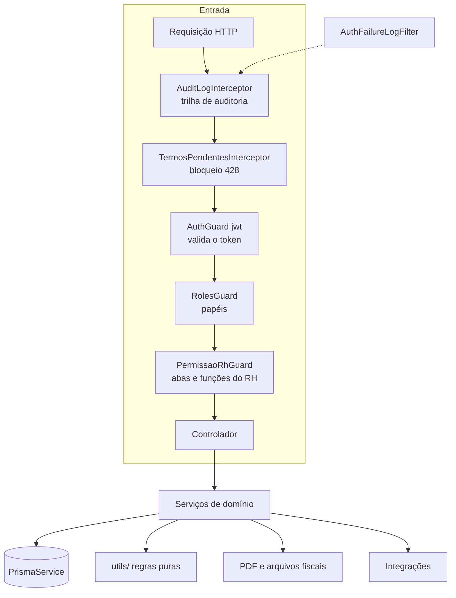

O backend é uma aplicação **NestJS** modular (um módulo por domínio), com prefixo global `/api`, validação global (`ValidationPipe` com `whitelist` e `transform`) e acesso a dados via **Prisma**.

## Módulos

| Módulo                                                                                                                           | Responsabilidade                                                                                                                                                                                                   |
| -------------------------------------------------------------------------------------------------------------------------------- | ------------------------------------------------------------------------------------------------------------------------------------------------------------------------------------------------------------------ |
| `auth`                                                                                                                           | Estratégia JWT/Keycloak, guardas de papéis/grupos/perfis do RH, sincronização do usuário no login.                                                                                                                 |
| `ponto`                                                                                                                          | Registro de ponto, histórico, solicitações, banco de horas, férias, configurações, gestão de funcionários, feriados, fotos, documentos.                                                                            |
| `auditoria`                                                                                                                      | Visões do RH e do gestor: dashboards, equipe, aprovação de solicitações, correções do RH, liberação de banco, relatórios.                                                                                          |
| `assinatura`                                                                                                                     | Espelho de Ponto: elegibilidade, assinaturas, PDF imutável, selo, ciclo de banco, verificação pública.                                                                                                             |
| `rep`                                                                                                                            | Livro do REP: NSR, marcações e eventos imutáveis, cadeia de hash, instância, relógio.                                                                                                                              |
| `arquivos-fiscais`                                                                                                               | AFD, AEJ, Atestado Técnico e configuração do REP-P.                                                                                                                                                                |
| `comprovante`                                                                                                                    | Comprovante de Registro de Ponto (PDF A6 assinado) e verificação pelo hash.                                                                                                                                        |
| `selo-icp`                                                                                                                       | Selo ICP-Brasil (PAdES/CAdES) com o e-CNPJ A1.                                                                                                                                                                     |
| `termos-uso`                                                                                                                     | Versões do termo, aceite e bloqueio por pendência.                                                                                                                                                                 |
| `notificacao`                                                                                                                    | Notificações no sistema e por e-mail; tarefas agendadas de avisos.                                                                                                                                                 |
| `requisicao-rh`, `saude-ocupacional`                                                                                             | Requisições do RH e exames ocupacionais.                                                                                                                                                                           |
| `perfis-rh`, `sistema`                                                                                                           | Perfis/permissões do RH; Super Admin, Start e gestão de usuários.                                                                                                                                                  |
| `logs`, `ingest`, `backup`, `api-servidora`, `admin`, `extensions`, `glpi`, `chat`, `content`, `org`, `area-modules`, `realtime` | Logs e auditoria, ingestão e monitor, agente de backup, API pública (feriados/configurações), administração do Keycloak, sincronização de ramais, GLPI, chat, conteúdo, organização e eventos em tempo real (SSE). |
| `documentacao`                                                                                                                   | Esta documentação técnica.                                                                                                                                                                                         |

## Padrões

- **Controladores finos**: validam entrada, aplicam guardas e chamam serviços.
- **Regras puras em `utils/`**: cálculo de horas, banco, jornada, categorias, férias, licenças — testáveis sem banco.
- **Transações** (`$transaction`) onde a consistência importa: marcação + NSR, aprovações, liberações.
- **Datas civis em Brasília**: utilitários dedicados (`horario-brasilia`) evitam erros de fuso.
- **Livro do REP somente inclusão**: gatilhos no PostgreSQL impedem UPDATE/DELETE/TRUNCATE.
