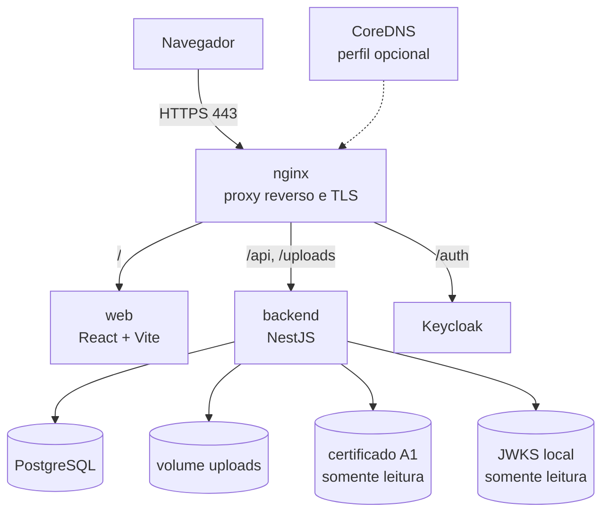

Visão de **contêineres** (C4 nível 2), conforme `docker-compose.yml`.

| Contêiner  | Tecnologia                | Função                                                                                 |
| ---------- | ------------------------- | -------------------------------------------------------------------------------------- |
| `postgres` | PostgreSQL                | Banco único da aplicação; volume persistente.                                          |
| `backend`  | Node.js + NestJS + Prisma | API REST sob `/api`; rotinas agendadas; geração de PDFs e arquivos fiscais.            |
| `web`      | React 18 + Vite           | Aplicação de página única (SPA).                                                       |
| `nginx`    | nginx                     | TLS 1.2/1.3, proxy para web, API e uploads; limite de corpo de 15 MB nas rotas de API. |
| `dns`      | CoreDNS (perfil `dns`)    | Resolução interna opcional dos nomes do sistema.                                       |

O repositório é montado em `/app` nos contêineres `backend` e `web`; o backend instala dependências quando o `package-lock.json` muda e executa `prisma db push` na subida. Os volumes do certificado ICP e do JWKS são montados **somente leitura**.
