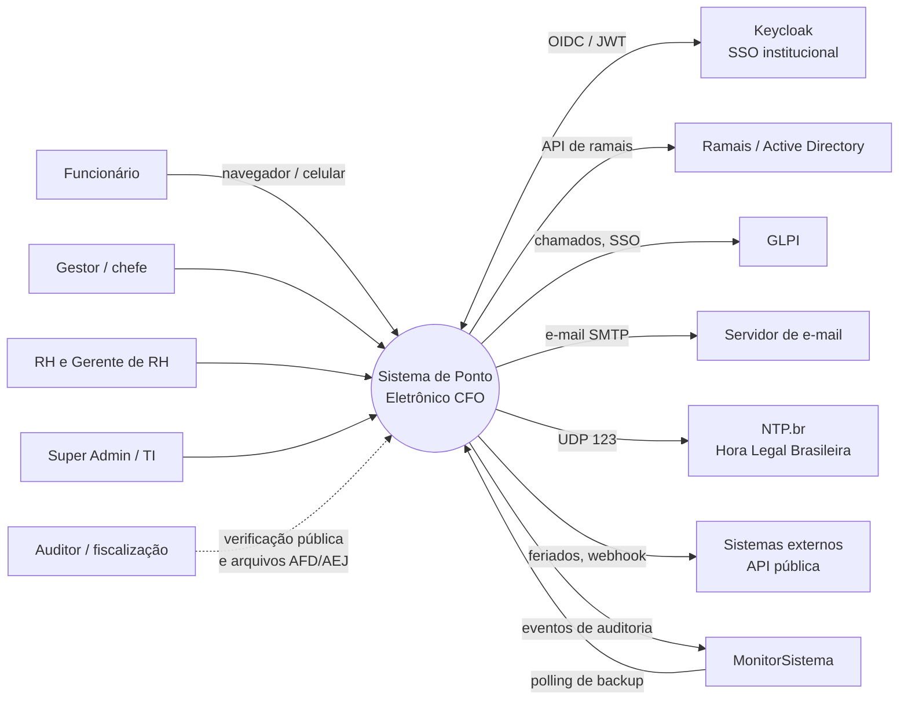

Visão de **contexto** (C4 nível 1): quem usa o sistema e com quais sistemas externos ele conversa.

## Responsabilidades

| Elemento       | Papel                                                                                     |
| -------------- | ----------------------------------------------------------------------------------------- |
| Keycloak       | Autentica o usuário e emite o token; o sistema só **valida** tokens, nunca guarda senhas. |
| Ramais/AD      | Origem do cadastro de pessoas e da hierarquia (gestores).                                 |
| GLPI           | Abertura/vínculo de chamados e SSO.                                                       |
| NTP.br         | Referência de hora para garantir variação máxima de 30 s (Anexo IX, item 2).              |
| MonitorSistema | Agenda e recebe os backups; recebe eventos de auditoria.                                  |
| Fiscalização   | Recebe AFD/AEJ/Atestado e pode conferir documentos na página pública de verificação.      |
