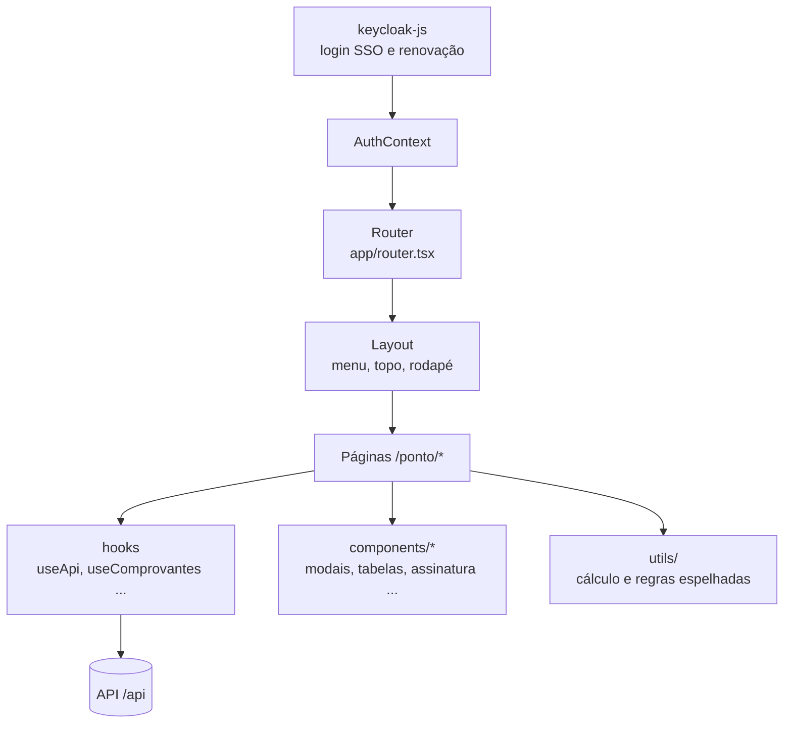

SPA em **React 18** com **Vite**, roteamento por `react-router` e autenticação por `keycloak-js`.

- **Páginas** ficam em `pages/ponto/*` e são carregadas sob demanda (`lazy`).
- **`useApi`** anexa o token (`Authorization: Bearer`) e trata 401/403/428.
- **Regras espelhadas** (`utils/`): partes do cálculo existem também no front para exibir prévias; o **backend é a autoridade**.
- **Acessibilidade**: menu de acessibilidade, orientação travada em telas pequenas, componentes com foco visível.
- **Terminais móveis**: GPS e câmera pelo navegador, com guias de permissão (Android/iOS).
