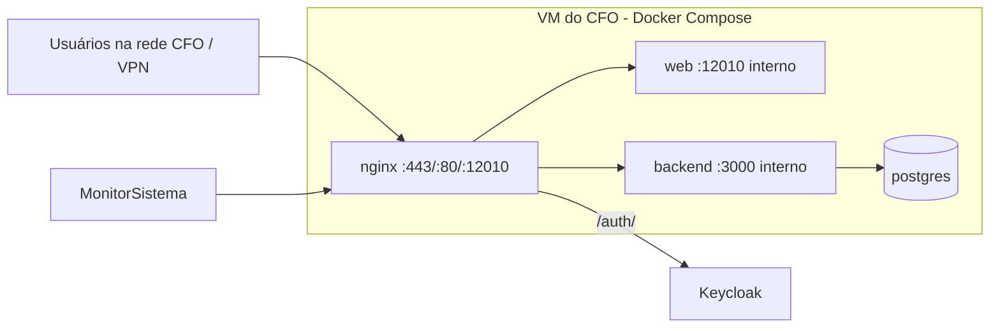

## Rede e portas

| Porta             | Uso                                                                     |
| ----------------- | ----------------------------------------------------------------------- |
| 80                | Redireciona para HTTPS.                                                 |
| 443               | Entrada principal (`ponto.cfo.org.br`, `ponto.cfo.local`), TLS 1.2/1.3. |
| 12010             | Entrada alternativa HTTPS (acesso direto/homologação).                  |
| 3000 (interno)    | API NestJS; **não exposta** diretamente.                                |
| 12001 (publicada) | PostgreSQL para administração local.                                    |

O nginx encaminha `/api/` e `/uploads/` ao backend (corpo máximo de 15 MB), `/auth/` e `/resources/` ao Keycloak institucional e o restante ao front-end.

## Volumes

| Volume                                | Conteúdo                                                        |
| ------------------------------------- | --------------------------------------------------------------- |
| `postgres_data`                       | Dados do banco.                                                 |
| `uploads_fotos`                       | Fotos de ponto, documentos enviados e PDFs finais dos Espelhos. |
| `./deploy/icp` (somente leitura)      | Certificado A1 do selo ICP-Brasil (fora do repositório).        |
| `./deploy/keycloak` (somente leitura) | JWKS local (chaves públicas do Keycloak).                       |
| `node_modules_root`                   | Dependências instaladas.                                        |

## Ambientes

Desenvolvimento e produção usam o mesmo `docker-compose.yml`; o script `scripts/docker-up.sh --build` reconstrói e sobe os serviços. Veja _Implantação e atualização_.
