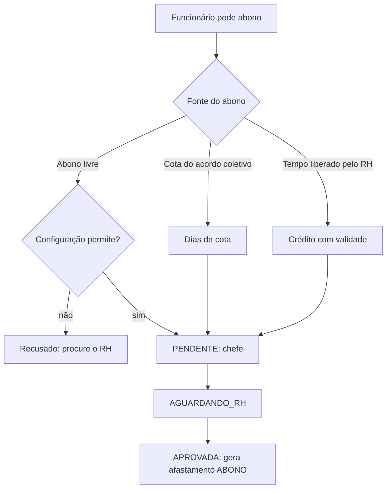

## Abono

Abono é a justificativa de ausência/atraso sem desconto. Pode ter **vários períodos** (data, início e fim, ou dia inteiro).

- **Tempo liberado**: o crédito liberado pelo RH tem prioridade e é consumido pelo abono (a liberação já debitou o banco; o abono apenas consome o crédito).
- **Abono livre** só existe com a opção ligada em _Configurações → Solicitações_ (ou dispensa do RH, com justificativa registrada).
- **Cota do acordo coletivo**: abono diário independente do crédito.
- O servidor **recalcula** minutos por dia e confere disponibilidade e validade; o front só exibe prévias.
- Períodos que já têm solicitação aprovada não podem ser pedidos de novo.

## Hora extra

- **Solicitada** pelo funcionário (tipo `HORA_EXTRA`); estagiário e jovem aprendiz **não** fazem hora extra.
- **Automática**: ao registrar a `SAIDA`, se o excesso passa de `horaExtraLimiteAuto` (padrão 120 min), o sistema cria a solicitação.
- Aprovação em duas etapas (chefe → RH). O saldo vai para o banco de horas com os multiplicadores de sábado, domingo e feriado (padrões 100%, 200%, 200%).
- A decisão sobre o que é hora extra, banco ou compensação segue `hora-extra-decisao` (regra do dia, local e tolerância de 10 min).
