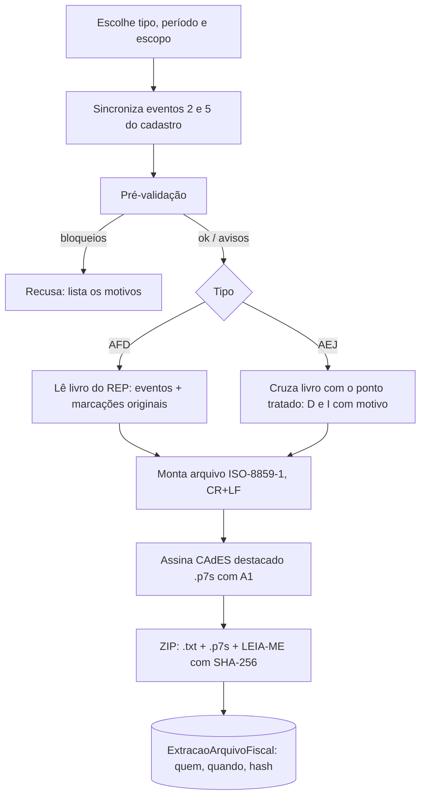

Arquivos exigidos pela fiscalização (Portaria MTP 671/2021, arts. 79–89). Geração em _Configurações → REP-P / Arquivos fiscais_ (RH/Super Admin).

## AFD (Arquivo Fonte de Dados)

- **Oficial** = todos os funcionários, direto do **livro imutável**: registros tipo 2 (empresa), 4 (ajuste de relógio), 5 (empregados), 6 (eventos sensíveis) e 7 (marcações), em ordem de NSR, versão 004.
- **Extrato** = parte dos funcionários; sai com o prefixo `EXTRATO_` e **não substitui** o oficial.
- Nome: `AFD` + nº do INPI (17 dígitos) + CNPJ + `REP_P`.

## AEJ (Arquivo Eletrônico de Jornada)

Trata o ponto: jornadas, horários contratuais, marcações do livro e as **correções** (marcações "D" desconsideradas e "I" incluídas, com motivo). Cabeçalho identifica o programa (PTRP) e o REP.

## Pré-validação

**Bloqueios**: funcionário com marcação no período e sem CPF; livro com integridade quebrada; certificado ICP vencido. **Avisos**: INPI não informado (cabeçalho com zeros), REP-P ainda em homologação, certificado ausente (saem **sem** `.p7s` — não aptos à fiscalização), marcações reconstituídas, extrato.

## Assinatura e rastreio

Cada `.txt` recebe um `.p7s` (CAdES destacado, SHA-256, política AD-RB v2.3). O `LEIA-ME.txt` traz período, geração, linhas, codificação, SHA-256 e maior NSR. Cada geração grava `ExtracaoArquivoFiscal` e entra na auditoria.

## Atestado Técnico e Termo de Responsabilidade (art. 89)

`GET /api/ponto/config/rep-p/atestado` devolve o modelo preenchido (dados da instituição, programa, versão, INPI) para **assinatura com e-CPF** do responsável.
