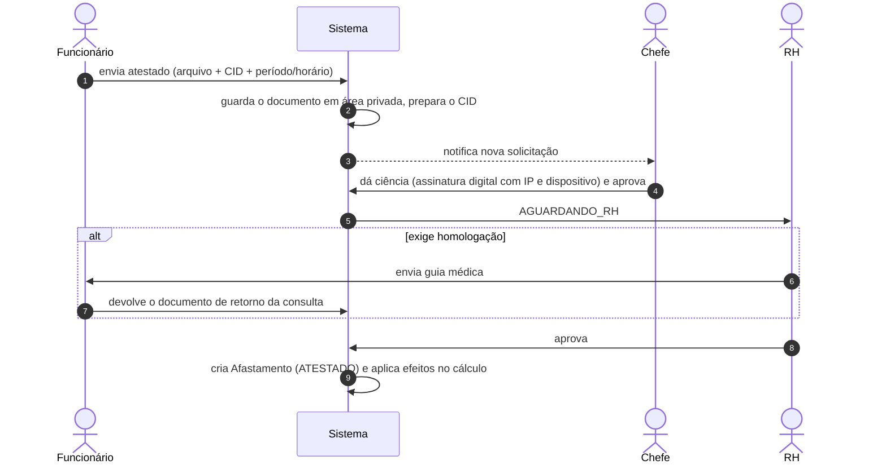

## Atestado médico

- **Ciência do chefe**: a aprovação do chefe exige metadados de assinatura (IP real, gateway e _user agent_) — registro de que o chefe tomou ciência do atestado; a ciência fica no documento e na trilha.
- **Atestado parcial** (horário de início e fim): o cálculo credita tempo de deslocamento na ida e na volta, limitado pelas tolerâncias de _Configurações → Solicitações_ (`atestadoTempoIdaMin`, `atestadoTempoRetornoMin`). O registro de ponto do dia recebe uma anotação explicando o crédito.
- **Homologação**: quando exigida, o RH não aprova antes de o funcionário devolver o documento de retorno.
- O **CID** é classificado por grupos (`CidGrupo`); o RH pode corrigir o CID depois, ficando registrado.
- O documento só é acessível a quem tem permissão (RH, chefe, o próprio funcionário) — nunca por URL pública.

## Licenças

As licenças são **configuráveis** pelo RH (`TipoLicenca`): nome, categorias que podem pedir, modo de duração (limite, fixo ou livre), prorrogação, contagem (corridos ou úteis), ocorrências por janela de meses, se permite parcial, se exige documento, orientação e **efeito** (afastamento ou redução de jornada com percentual máximo). Os padrões seguem o art. 473 da CLT e o ACT.

1. O funcionário escolhe o tipo; o servidor valida categoria, duração, janela de ocorrências e documento.
2. Fluxo `PENDENTE` (chefe) → `AGUARDANDO_RH` → `APROVADA`.
3. Aprovada, cria o `Afastamento` (ou aplica a redução de jornada). Licença maternidade/paternidade usam códigos de sistema.

## Efeito no ponto

Dia coberto por afastamento integral: sem registro de ponto, saldo **neutro**. O registro de ponto fica bloqueado no dia ("Você está em … hoje").

## Tabelas

`Solicitacao`, `Afastamento`, `TipoLicenca`, `CidGrupo`, `DocumentoRhEnvio`, `ConfiguracaoSolicitacoes`.
