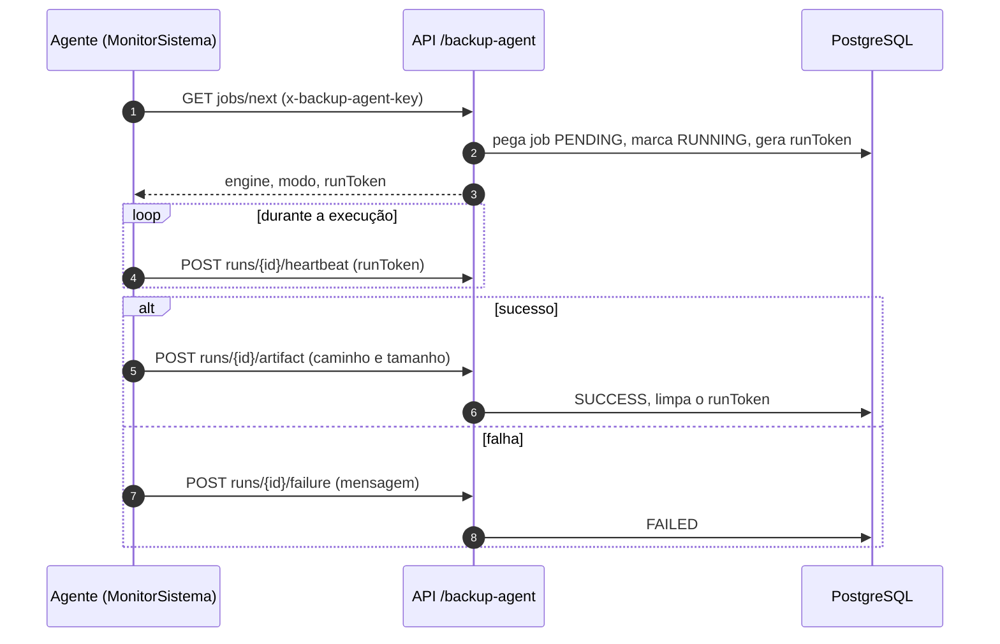

O backup é conduzido por um **agente externo** (MonitorSistema) que consulta a API; o sistema não executa `pg_dump` por conta própria.

- O Super Admin cria **jobs manuais** e vê o histórico (`BackupJob`, últimos 100).
- O `runToken` é aleatório (32 bytes) por execução e **zerado** ao concluir; sem ele o agente não consegue reportar.
- Todo dia à meia-noite, uma rotina limpa artefatos com **retenção expirada**.
- **Restauração**: feita fora do sistema. Depois de restaurar um backup antigo, o livro do REP pode ficar com NSR abaixo do exportado: nesse caso as marcações ficam bloqueadas até a TI conferir (ver _Runbook_).
- A guarda mínima de **5 anos** do livro do REP depende desses backups (item 7 do Anexo IX).
