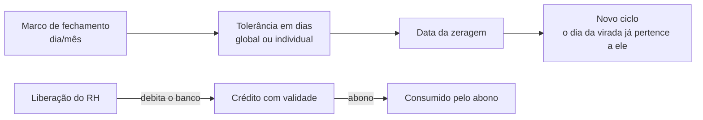

## Conceito

O saldo é a soma, dia a dia, de (horas trabalhadas − jornada devida), com multiplicadores para sábado, domingo e feriado. Dias de feriado e afastamento são **neutros**; falta é negativa. O saldo é contabilizado por **ciclo**.

## Etapas

1. **Marcos**: configurados em _Configurações → Banco de horas_ (anuais recorrentes ou únicos). O ciclo começa no último marco atingido; a próxima zeragem é o próximo marco.
2. **Tolerância de fechamento**: a zeragem ocorre N dias após o marco. A tolerância **individual** (definida pelo RH no cadastro) sobrepõe a geral, exceto para Estagiário, Jovem Aprendiz e Assessor (comissionado), que seguem só a geral.
3. **Cálculo diário**: jornada efetiva do dia (histórico de jornadas), registros, intervalo mínimo de almoço, tolerâncias de entrada/saída/cálculo, feriados, afastamentos, cessão, dias sem obrigação de ponto.
4. **Limite e vigência**: `bancoHorasLimiteMin` (padrão 120 min) e `bancoHorasVigenciaDias` (padrão 30).
5. **Liberação para abono**: o RH libera uma quantidade de minutos (mínimo 15) com validade (padrão 180 dias). A liberação **debita** o saldo do banco no dia, vira crédito que **sobrevive à zeragem** e pode ser **revogada** (devolvendo o saldo não usado). Há aviso quando o crédito está perto de vencer.
6. **Relatório do ciclo**: ao fim do ciclo, gera-se o PDF do ciclo, assinado pelo funcionário e selado (ver _Assinatura do Espelho_).
7. **Avisos**: no dia 1º, alerta de banco próximo do vencimento (`BANCO_HORAS_VENCIMENTO`); diariamente, de liberações vencendo.

## Quem não vê o banco

Estagiário e Jovem Aprendiz não têm banco de horas visível; o excedente é apenas informativo.

## Tabelas

`BancoHorasMarco`, `BancoHorasLiberacao`, `AssinaturaCicloBancoHoras`, `RegistroPonto`, `Afastamento`, `Solicitacao`, `ConfiguracaoSistema`, `Funcionario`.
