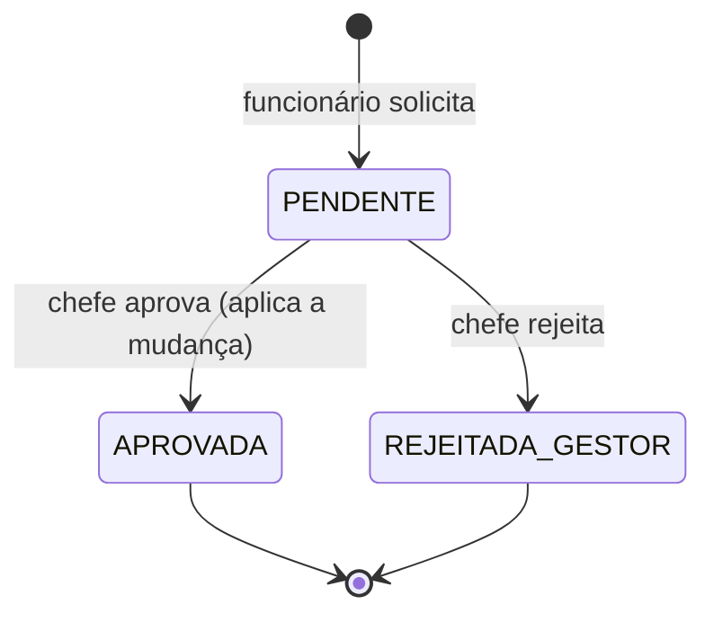

## Correção de ponto pelo funcionário

Serve para dias anteriores em que faltou batida ou houve erro. **Hoje e datas futuras não são aceitos.**

1. O funcionário abre **Solicitações → Correção de ponto**, informa a data, as batidas corretas e o motivo.
2. O sistema valida: dia anterior, folha do mês **ainda não assinada** (depois da assinatura a correção não é mais possível), sem solicitação aprovada conflitante.
3. O chefe aprova ou rejeita (não pode aprovar a própria solicitação). **A aprovação do chefe finaliza**: aplica a mudança nos registros do dia.
4. A mudança **não apaga** a marcação original: o livro do REP preserva a marcação ORIGINAL e o AEJ indica a desconsideração ("D") e a inclusão ("I") com o motivo.

## Correção criada pelo RH

O RH pode abrir a correção em nome do funcionário (fica marcada como _criada pelo RH_, com justificativa). Fluxo: `AGUARDANDO_GESTOR_RH` → aprovação do **Gerente de RH** (`PONTO_ADMIN`) → aplicada. Quem criou **não** pode aprovar.

## Regras comuns

- Observações do dia registram o ajuste (tipo `AJUSTE_AUTOMATICO` ou correção) e aparecem no Histórico e na Auditoria.
- Notificações são enviadas em cada etapa.

## Tabelas

`Solicitacao`, `RegistroPonto`, `MarcacaoRep`, `Notificacao`, `AuditLog`.
