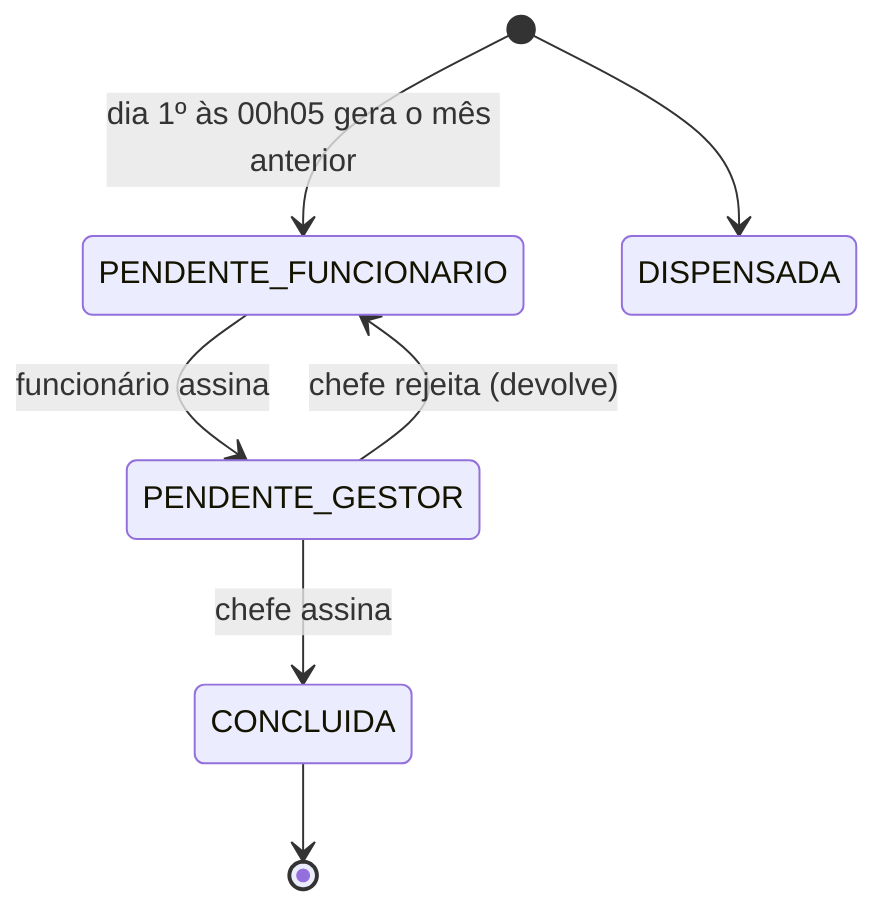

O **Espelho de Ponto** é a folha mensal assinada. Sai do banco como `AssinaturaQuadro`, vinculada ao `PeriodoPonto` do mês.

## Passo a passo

1. **Geração**: no dia 1º às 00:05 (Brasília), a rotina cria a assinatura do mês anterior para quem for **apto** — ativo, admitido e com primeiro acesso até o fim do mês, com obrigação de ponto em algum dia e não cedido o mês inteiro. O RH tem uma **prévia** da elegibilidade.
2. **Assinatura do funcionário**: só após o fim do mês e com o saldo **regularizado** (sem dias inconsistentes ou solicitações pendentes). O registro guarda data, IP real, IP do gateway e _user agent_. **Depois de assinar não é mais possível pedir correção do período.**
3. **Assinatura do chefe**: só quem tem autoridade sobre a equipe (ou Super Admin). O chefe pode **rejeitar**, devolvendo ao funcionário.
4. **Conclusão**: o PDF final é **congelado**: gerado a partir de um _fingerprint_ dos dados, **selado em PAdES com o e-CNPJ A1** (quando instalado), salvo em disco com hash SHA-256 e registrado em `DocumentoEmitido`. Se os dados mudarem, nova emissão substitui a anterior — o arquivo antigo deixa de ser servido e fica **apenas o hash no histórico** (`pdfHistorico`).
5. **Notificações**: `ASSINAR_QUADRO` (funcionário), `ASSINAR_QUADRO_GESTOR`, `ASSINATURA_CONCLUIDA`; diariamente às 00:10 avisa quem tem folha com correção pendente.
6. **Selo de página**: cada página do PDF recebe um selo HMAC (registro, página, total) que permite conferir que a folha não foi remontada.

## Relatório do ciclo de banco de horas

Fluxo equivalente para o ciclo (`AssinaturaCicloBancoHoras`): o funcionário assina o relatório do ciclo, o PDF é selado e registrado para verificação.

## Verificação

Qualquer pessoa, sem login, pode conferir o documento em `/verificar` pelo código, pelo QR selado ou enviando o arquivo (impressão digital SHA-256) — ver _Verificação de documentos_.

## Tabelas

`AssinaturaQuadro`, `PeriodoPonto`, `AssinaturaCicloBancoHoras`, `DocumentoEmitido`, `Notificacao`.
