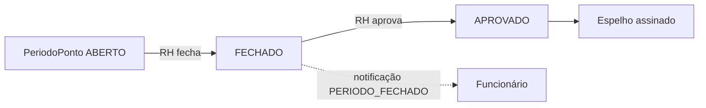

O fechamento mensal organiza o período e protege a folha contra alterações tardias.

1. O **período** (`PeriodoPonto`) acumula horas trabalhadas, extras, faltas e dias; o status vai de `ABERTO` → `FECHADO` → `APROVADO`.
2. **Ninguém fecha ou aprova o próprio período** (regra de segregação de função).
3. Ao fechar, o funcionário é notificado.
4. A **mudança de situação** (`FechamentoSituacao`) registra, quando a categoria/condição de ponto do funcionário muda (ex.: concursado → comissionado), a data, os rótulos de origem e destino, se havia obrigação de ponto e o **saldo do banco de horas naquele momento** — é o fechamento do banco por mudança de situação, com notificação ao RH.
5. O mês só pode ser **assinado** depois de encerrado; correções de ponto ficam bloqueadas após a assinatura do funcionário.
6. Os relatórios mensais (PDF) e a exportação CSV usam os mesmos números do Espelho.

## Tabelas

`PeriodoPonto`, `FechamentoSituacao`, `AssinaturaQuadro`, `RegistroPonto`.
