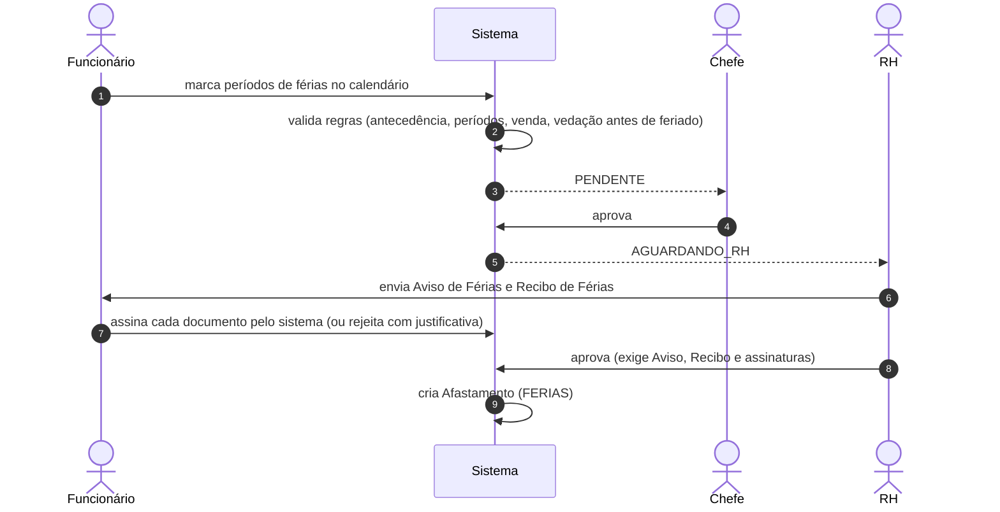

## Solicitação e aprovação

## Regras de marcação (editáveis em _Configurações → Solicitações_)

`antecedenciaMinDias`, `minimoGrandePeriodo`, `minimoOutrosPeriodos`, `maxPeriodos`, `maxDiasVenda` e `vedacaoPreFeriadoDias` — a mesma validação roda no front (prévia) e no servidor (autoridade).

## Documentos e assinatura

- O RH envia **Aviso** e **Recibo**; o funcionário os assina dentro do sistema. A assinatura grava IP, dispositivo e data.
- Se o funcionário **rejeitar** um documento, informa a justificativa; o RH corrige e reenvia — o reenvio **zera as assinaturas**.
- A aprovação do RH só é aceita com Aviso, Recibo, sem rejeição pendente e com a assinatura do funcionário.
- Os documentos assinados entram no registro de documentos emitidos e podem ser verificados na página pública.

## Rodadas e avisos

Há **rodadas** de documentos (por ordem) para férias fracionadas, com painel do RH e avisos: `FERIAS_RODADA_ASSINAR` (funcionário) e `FERIAS_RODADA_PENDENTE_RH`. Todo dia 1º do mês, a rotina verifica **férias obrigatórias** e notifica (`FERIAS_OBRIGATORIO`).

## Saldo e calendário

O saldo é calculado por ciclos aquisitivos (`calcularSaldoFeriasFuncionario`); o RH também pode **agendar, alterar ou cancelar** férias em nome do funcionário.

## Tabelas

`Solicitacao` (metadados com os documentos e assinaturas), `Afastamento`, `ConfiguracaoSolicitacoes`, `Notificacao`, `DocumentoEmitido`.

## Gozado × agendado

O saldo separa o que foi **realmente gozado** (data real já passou, em horário de Brasília; o dia de hoje conta, e um período em andamento conta só a parte decorrida) do que está **agendado** (datas futuras). `diasGozo` continua sendo o total programado (`diasGozados + diasAgendados`) por compatibilidade; o saldo disponível não muda. Regra de gozo imutável: o RH não cancela férias com período já iniciado (usa "Alterar" nos dias futuros). Funções: `separarGozoPorData` e `feriasJaIniciadas` em `utils/ferias-regras.ts`; teste: `scripts/teste-ferias-gozo.ts`.

## Controle geral de férias (aba "Férias" em /ponto/auditoria)

Quadro global (só leitura, recurso RH `ferias.controle`, `GET /ponto/ferias-controle/painel`) com todos os funcionários **ativos, exceto Alta Administração**. Cálculo em `utils/ferias-controle.ts` (função pura, não altera o saldo dos pedidos) e `modules/ferias-controle`. Horário de Brasília.

- **Ciclos:** TODOS desde a admissão: aquisitivo de 12 meses + concessivo de 12 meses seguintes (CLT 130 e 134).
- **Gravidade (do pior ao melhor):** Remuneração em dobro (concessivo encerrado sem gozo, art. 137) → vence em ≤30 dias → vence em ≤90 dias → vencida e não programada → parcial → fracionamento irregular (art. 134 §1º) → programada → em gozo → em dia → sem data de admissão (pendência de cadastro, por último).
- **Status:** Usufruído, Programado, Não programado. Colunas: gozados, agendados, abono (venda), adiantamento do 13º.
- **Adiantamento do 13º:** `metadados.adiantamento13` (booleano, opcional) na solicitação; o funcionário marca ao pedir, o RH ajusta ao agendar/alterar. Ausente = "não informado".
- **Marco inicial:** ciclos com concessivo encerrado antes da 1ª solicitação de férias do sistema (ou de `FERIAS_CONTROLE_MARCO_INICIAL`, AAAA-MM-DD) não são avaliados, para não gerar "em dobro" falso por falta de histórico.
- **Limites:** não considera suspensão do aquisitivo por afastamento (art. 133) nem perda de dias por faltas (art. 130).
- Teste: `scripts/teste-ferias-controle.ts`.

## Aceite, documentos e aprovação (revisão)

**Aceite (férias configuradas pelo RH):** o chefe imediato **ou** o Gerente de RH (`ponto-admin`/`PONTO_ADMIN`, discricionário) — vale o primeiro que decidir (`gestorResolverSolicitacao`, transição condicional; `metadados.aceite = {por, nome, em}`). Em férias pedidas pelo funcionário o chefe continua sendo o único aceite.

**Documentos (nos dois processos):** Aviso e Recibo de Férias são enviados **separadamente** (`PATCH /auditoria/rh/solicitacoes/:id/ferias/documentos/:tipo`, tipo AVISO | RECIBO | OUTROS), a partir do aceite, sem apagar os demais nem as assinaturas. Estado por documento em `metadados.documentosFerias[]` (`enviadoEm`, `urlAssinado`, `rejeicao`, `ultimoLembreteEm`).

- **Aviso:** o funcionário assina até o **1º dia de gozo**; **assinar o Aviso aprova as férias** (afastamentos criados — `finalizarFeriasPorAssinatura`). Rejeitou → volta ao RH (`AGUARDANDO_RH`) com o comentário; o RH reenvia só o Aviso.
- **Recibo:** assina até o **fim do mês do término do gozo**, em paralelo; não trava a aprovação.
- O RH não tem mais o clique final "Aprovar" em férias (só "Rejeitar" na etapa dele); o ramo antigo (tudo já assinado antes da mudança) continua aprovável.
- **Lembretes** (`lembrarAssinaturaDocumentosFerias`, 07:30 Brasília): e-mail e aviso no sistema 1x por semana e, nos últimos 4 dias do prazo, todos os dias; documento vencido: para de cobrar o funcionário e alerta o RH a cada 7 dias (`FERIAS_DOCUMENTO_ASSINAR`, `FERIAS_DOCUMENTO_VENCIDO`). Regras puras em `utils/ferias-documentos.ts` (espelho `web/src/utils/feriasDocumentos.ts`).
- Rodadas do 2º/3º período (`rodadasFerias`, após a aprovação): Aviso e Recibo também por documento (`PATCH …/ferias/rodadas/:ordem/documentos/:tipo`); a rodada conclui quando os dois estão assinados (`situacaoDaRodada`). O quadro de Controle de Férias mostra a coluna Documentos (pendentes/vencidos).
- Testes: `scripts/teste-ferias-documentos.ts`, `scripts/teste-ferias-fluxo-documentos.ts`.
