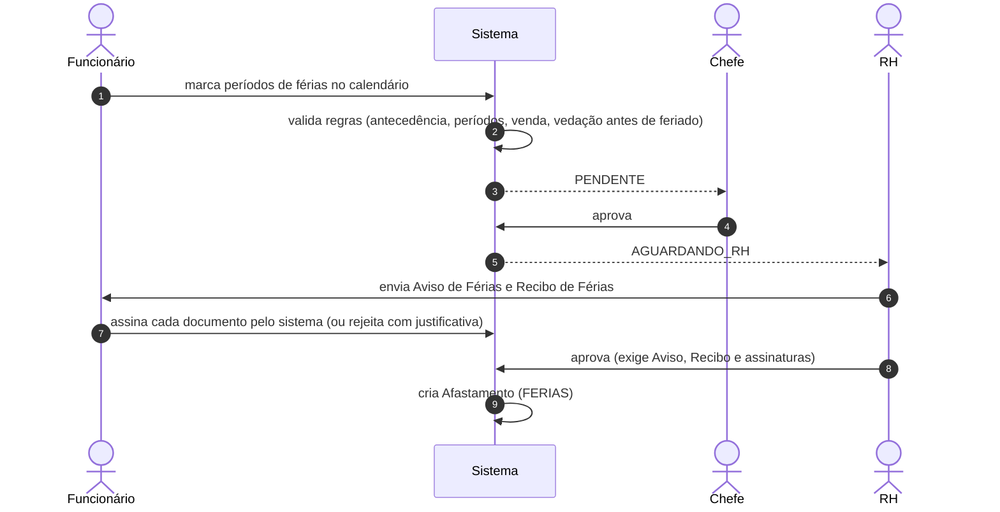

## Solicitação e aprovação

## Regras de marcação (editáveis em _Configurações → Solicitações_)

`antecedenciaMinDias`, `minimoGrandePeriodo`, `minimoOutrosPeriodos`, `maxPeriodos`, `maxDiasVenda` e `vedacaoPreFeriadoDias` — a mesma validação roda no front (prévia) e no servidor (autoridade).

## Documentos e assinatura

- O RH envia **Aviso** e **Recibo**; o funcionário os assina dentro do sistema. A assinatura grava IP, dispositivo e data.
- Se o funcionário **rejeitar** um documento, informa a justificativa; o RH corrige e reenvia — o reenvio **zera as assinaturas**.
- A aprovação do RH só é aceita com Aviso, Recibo, sem rejeição pendente e com a assinatura do funcionário.
- Os documentos assinados entram no registro de documentos emitidos e podem ser verificados na página pública.

## Rodadas e avisos

Há **rodadas** de documentos (por ordem) para férias fracionadas, com painel do RH e avisos: `FERIAS_RODADA_ASSINAR` (funcionário) e `FERIAS_RODADA_PENDENTE_RH`. Todo dia 1º do mês, a rotina verifica **férias obrigatórias** e notifica (`FERIAS_OBRIGATORIO`).

## Saldo e calendário

O saldo é calculado por ciclos aquisitivos (`calcularSaldoFeriasFuncionario`); o RH também pode **agendar, alterar ou cancelar** férias em nome do funcionário.

## Tabelas

`Solicitacao` (metadados com os documentos e assinaturas), `Afastamento`, `ConfiguracaoSolicitacoes`, `Notificacao`, `DocumentoEmitido`.
