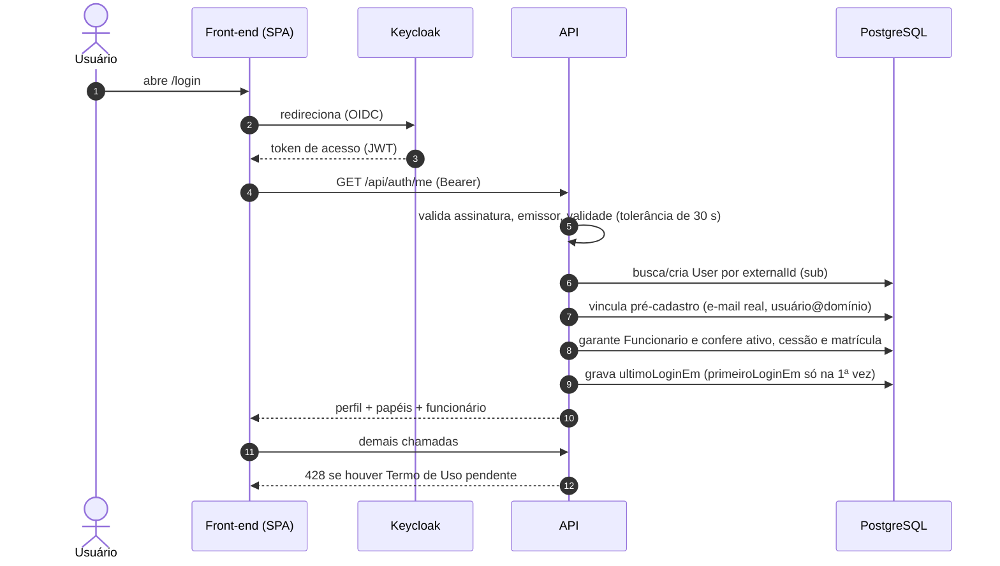

## Visão geral

O usuário entra uma única vez pelo **Keycloak** (SSO institucional). O front guarda o token em memória, anexa-o a cada chamada e o renova antes de expirar. A cada login o backend **sincroniza** o usuário com o cadastro local.

## Regras

1. **Papéis**: o token traz `realm_access.roles`; todo usuário recebe `funcionario`. O servidor acrescenta `RH_AUDITORIA` (lotado na gerência de RH), `GESTOR_APROVACAO` e `gestor` (chefe de gerência, equipe cadastrada ou supervisor de estagiário/jovem aprendiz) e, para o Super Admin, todos os papéis.
2. **Super Admin**: nome de usuário/e-mail em `SUPER_ADMIN_USERNAMES` **ou** concessão ativa em `SuperAdminConcessao`.
3. **Bloqueios** (HTTP 403 com código): `CONTA_DESATIVADA` (funcionário inativo), `CONTA_CEDIDA` (cessão a outro órgão cobrindo hoje), `SEM_MATRICULA` (não consta no quadro oficial). O Super Admin não é bloqueado.
4. **Pré-cadastro**: usuários importados pela API de ramais ainda sem `sub` são vinculados pelo e-mail real (`usuário@cfo.org.br`) ou por prefixo do usuário — sem duplicar pessoas.
5. **Primeiro login** (`primeiroLoginEm`) é gravado uma única vez e serve de marco para **não contar falta** em dias anteriores ao primeiro acesso real.
6. Falha ao baixar as chaves remotas do Keycloak não derruba o sistema: o backend usa o **JWKS local** montado em arquivo.

## Telas e endpoints

`/login` → `GET /api/auth/me`. Acesso negado mostra mensagem específica por código.
