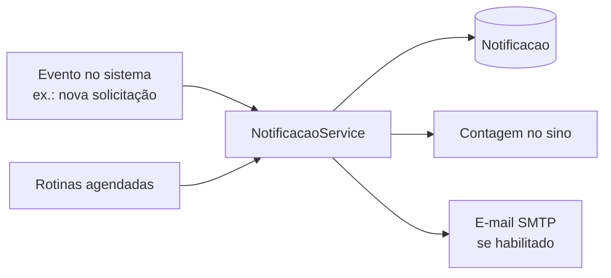

As notificações aparecem no **sino** e na página `/ponto/notificacoes` e, conforme a configuração, também por **e-mail**.

## Tipos (identificador do evento)

| Grupo          | Eventos                                                                                                                                                        |
| -------------- | -------------------------------------------------------------------------------------------------------------------------------------------------------------- |
| Solicitações   | `SOLICITACAO_NOVA_GESTOR`, `SOLICITACAO_AGUARDANDO_RH`, `SOLICITACAO_APROVADA`, `SOLICITACAO_RECUSADA`, `SOLICITACAO_CRIADA_PELO_RH`, `AFASTAMENTO_REGISTRADO` |
| Documentos     | `RH_DOCUMENTO_ENVIADO`, `DOCUMENTO_RETORNO_PENDENTE`, `REQUISICAO_RH`                                                                                          |
| Assinaturas    | `ASSINAR_QUADRO`, `ASSINAR_QUADRO_GESTOR`, `ASSINATURA_CONCLUIDA`, `FOLHA_PONTO_CORRECAO_PENDENTE`, `PERIODO_FECHADO`                                          |
| Ponto          | `REGISTRO_PONTO`, `REGISTRO_PONTO_INCOMPLETO`                                                                                                                  |
| Férias         | `FERIAS_OBRIGATORIO`, `FERIAS_RH`, `FERIAS_RODADA_ASSINAR`, `FERIAS_RODADA_PENDENTE_RH`                                                                        |
| Banco de horas | `BANCO_HORAS_VENCIMENTO`, `BANCO_HORAS_LIBERADO`, `BANCO_HORAS_LIBERADO_VENCENDO`, `FECHAMENTO_BANCO_MUDANCA_SITUACAO`                                         |
| Saúde          | `EXAME_OCUPACIONAL_A_VENCER`, `EXAME_OCUPACIONAL_VENCIDO`, `EXAME_OCUPACIONAL_ENVIADO`, `EXAME_OCUPACIONAL_DEVOLVIDO`                                          |
| Governança     | `SUPER_ADMIN_CONCEDIDO`, `SUPER_ADMIN_REVOGADO`, `PAPEL_CRITICO_DESATIVADO`, `SISTEMA_START_*`, `SELO_ICP_VENCENDO`                                            |

## Regras

- Cada evento é identificado por `tipo` e pode ser habilitado/desabilitado por canal em _Configurações → Notificações_.
- A notificação é por **usuário** (`userExternalId` = `sub` do Keycloak) com `lida`/`criadoEm`.
- Falha no e-mail **não** impede a notificação no sistema nem a operação que a originou (erros são registrados e ignorados).
- Provedores de e-mail da configuração: SMTP manual, Locaweb ou Microsoft (STARTTLS).
