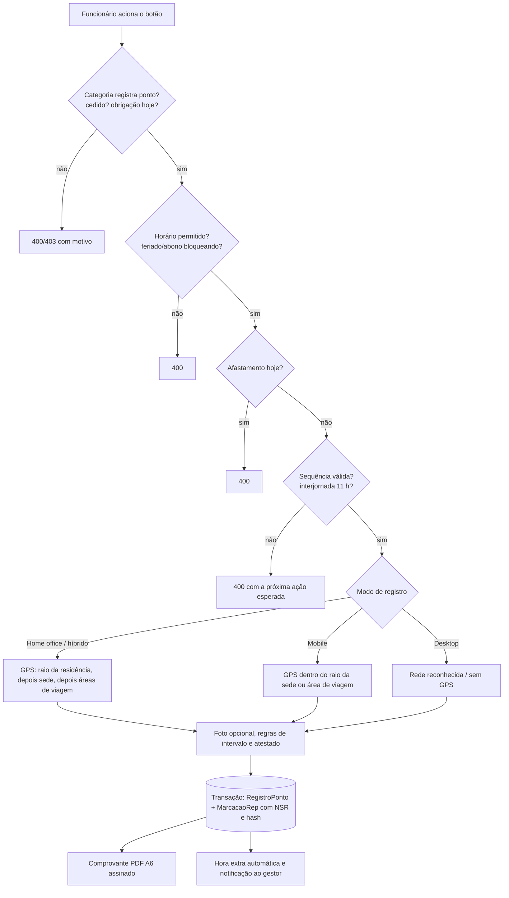

## Visão geral

A marcação é feita em `/ponto/registrar`. O servidor é a autoridade: **hora**, **sequência**, **perímetro** e **NSR** são decididos no backend (`POST /api/ponto/registros`).

## Passo a passo

1. **Hora do servidor**: o relógio exibido é ancorado em `GET /api/ponto/hora`; a hora gravada é a do servidor. O dispositivo não influencia.
2. **Pré-condições**: funcionário que registra ponto (estagiário/jovem aprendiz registram; cedido e isentos não), obrigação de ponto no dia (categoria vigente), janela de horário (`pontoHorarioMinimo`/`Maximo`), feriado ou dia abonado (bloqueio total ou parcial por horário), afastamento no dia.
3. **Sequência**: o estado do dia (`getStatusAtual`) define as ações permitidas (`ENTRADA`, `INICIO_INTERVALO`, `FIM_INTERVALO`, `SAIDA`, `INTERROMPER_EXPEDIENTE`, `REINICIAR_EXPEDIENTE`). Na janela do almoço (padrão 11:30–13:00) pausa e encerramento ficam indisponíveis. Estagiário e jovem aprendiz cumprem carga corrida: usam pausa/retomada, não almoço.
4. **Interjornada**: a `ENTRADA` é recusada enquanto não passar o descanso mínimo (padrão 11 h) desde a última saída.
5. **Local**: depende do modo do funcionário.
   - _Home office/híbrido_: exige GPS; vale se estiver dentro do raio da residência (padrão 20 m) — no híbrido respeitando o limite de dias por semana — ou na sede, ou em área de viagem (se o modo viagem estiver ativo).
   - _Mobile_: com `mobileCheckGeo`, exige GPS dentro do raio da sede (padrão 200 m) ou de área de viagem.
   - _Desktop_: valida a rede reconhecida (sub-redes/provedores configurados).
6. **Saída sem almoço**: o sistema completa Início/Fim de intervalo com duração zero e anota a dedução automática; em casa, com a regra do ciclo completo ativa, a saída exige o almoço registrado.
7. **Atestado parcial**: créditos de deslocamento (ida e volta) são anotados no registro, limitados à tolerância configurada.
8. **Gravação**: em **uma transação**, cria `RegistroPonto` e a marcação original no livro do REP — NSR reservado por `UPDATE … RETURNING`, hash SHA-256 encadeado — e devolve o **NSR** ao cliente.
9. **Pós-gravação**: abre o _Comprovante de Registro de Ponto_; saída pode gerar solicitação de hora extra automática; entrada/saída notificam o gestor; foto vira foto de perfil se não houver.
10. **Indisponibilidade (503)**: se a cadeia de hash estiver quebrada, houver segunda instância ativa ou o relógio estiver a mais de 30 s da hora legal, nenhuma marcação é aceita até a TI resolver.

## Dados envolvidos

`RegistroPonto`, `MarcacaoRep`, `ContadorNsr`, `ConfiguracaoSistema`, `Funcionario`, `EnderecoResidencial`, `AreaViagem`, `FeriadoConfig`, `Afastamento`, `JornadaPeriodo`.
