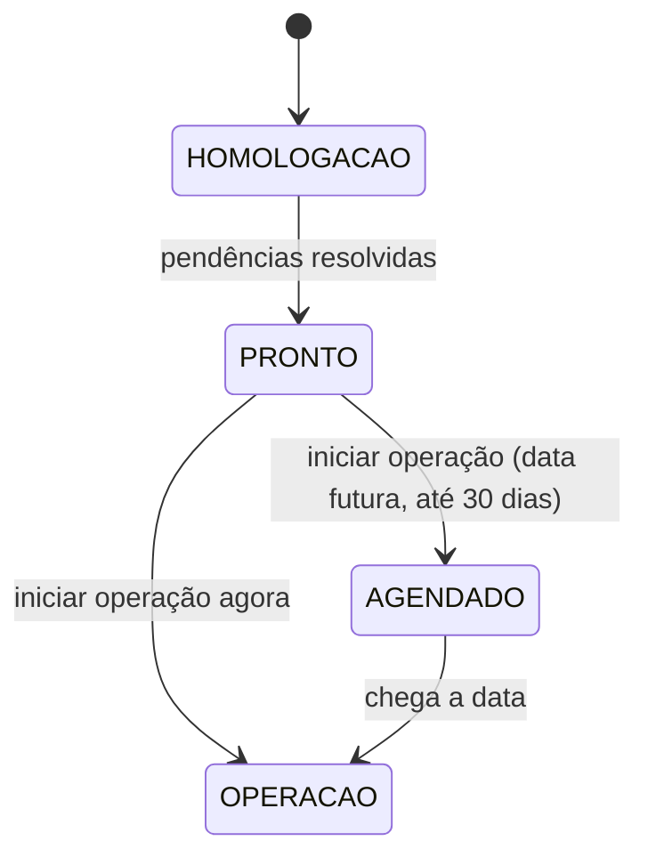

A **virada** é o ato de passar o sistema de homologação para operação como REP-P. Fica em _Configurações → REP-P_ (Super Admin).

## Pendências para iniciar

1. Informar o **nº de registro no INPI** e o **CNPJ** da instituição.
2. Concluir a etapa **"Certificado de registro recebido"** e informar **número e data** do certificado do INPI.
3. (Recomendado) certificado A1 instalado, para os arquivos saírem assinados.

## Registro do programa no INPI (art. 91)

O sistema guarda os dados do registro (`RegistroProgramaInpi`): hash do código, etapas (protocolo, taxa, certificado), número e data do certificado e o **PDF do certificado** (guardado com segurança). O hash do código-fonte vem de `npm run rep:hash` (`scripts/inpi-hash.sh`) e cobre **somente o núcleo de registro de ponto** (veja _Integridade do código_ abaixo).

## Integridade do código (hash do núcleo de registro)

- **Escopo mínimo** (`packages/backend/rep-escopo.json`): livro do REP (`rep-livro.service`), vigência/hora oficial (`rep-p.service`), `rep.module`, o núcleo `registro-ponto.core` (cria o registro e grava no livro na mesma transação), `afd-campos`, `instancia-rep`, `registro-observacoes`, o DTO de registro e só os modelos Prisma `RegistroPonto`, `MarcacaoRep`, `EventoRep`, `ContadorNsr`, `VigenciaRep` e `InstanciaRep`. Mudanças em outras funcionalidades **não** alteram o hash.
- **Hash determinístico** (`rep/escopo-hash.ts`): SHA-256 da lista ordenada de arquivos, com texto normalizado (LF, sem BOM). Não depende de git, commit nem data.
- **Lacre** (`rep-escopo.lock.json`): guarda o hash aceito. `npm run rep:verificar` compara; o hook de pré-commit e o CI **bloqueiam** divergência. O prettier/eslint automáticos **não** tocam nesses arquivos, e `npm run rep:proteger` deixa-os somente leitura.
- **Alteração intencional**: o Super Admin define a **senha root** em Sistema → Integridade do código (campo com ícone de olho; a senha atual aparece em pontinhos e toda exibição é registrada), gera um token de 30 min com ela, e o desenvolvedor roda `npm run rep:liberar -- <token>`, altera, e `npm run rep:selar -- --motivo "…"`. O servidor recalcula o hash, registra o selo (quem, quando, motivo, arquivos) e o novo hash deve ser registrado no INPI.
- **No servidor**: na subida e 1×/dia o backend compara os arquivos com o lacre; divergência gera log de erro, notificação aos Super Admins e o selo "Alterado" na aba. O registro de ponto **não** é bloqueado por isso.

## Ao iniciar

Cria uma `VigenciaRep` (tipo `REP_P`, início, registro vinculado, quem criou). O início **não pode estar no passado** nem a mais de 30 dias. A partir do início, AFD/AEJ saem como oficiais e o comprovante usa o número do INPI.

## Monitor do relógio e integridade

- **NTP**: a cada 5 minutos o servidor confere a Hora Legal Brasileira (4 servidores do NTP.br). Com **duas medições seguidas** acima de 30 s, as marcações são bloqueadas (503) até normalizar.
- **Instância**: a identidade da VM é registrada (`InstanciaRep`); uma **segunda instância ativa** bloqueia novas marcações para evitar NSR duplicado.
- **NSR exportado**: se o NSR atual ficar abaixo do último exportado (ex.: restauração de backup antigo), as marcações são bloqueadas.
- **Cadeia de hash**: verificada na subida e uma vez por dia; quebra bloqueia marcações e alerta.
- Estado, pendências e medições aparecem no painel e entram no Anexo IX.
