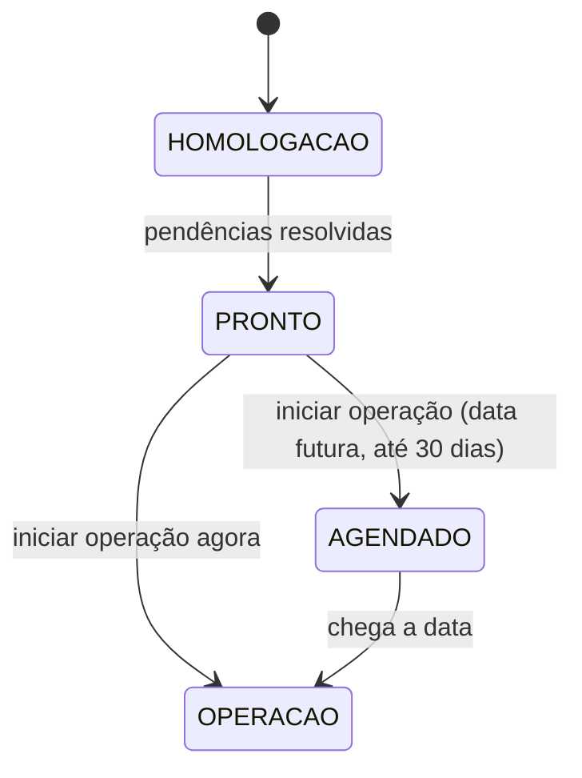

A **virada** é o ato de passar o sistema de homologação para operação como REP-P. Fica em _Configurações → REP-P_ (Super Admin).

## Pendências para iniciar

1. Informar o **nº de registro no INPI** e o **CNPJ** da instituição.
2. Concluir a etapa **"Certificado de registro recebido"** e informar **número e data** do certificado do INPI.
3. (Recomendado) certificado A1 instalado, para os arquivos saírem assinados.

## Registro do programa no INPI (art. 91)

O sistema guarda os dados do registro (`RegistroProgramaInpi`): hash do código, etapas (protocolo, taxa, certificado), número e data do certificado e o **PDF do certificado** (guardado com segurança). O script `scripts/inpi-hash.sh` calcula o hash do código-fonte para o pedido.

## Ao iniciar

Cria uma `VigenciaRep` (tipo `REP_P`, início, registro vinculado, quem criou). O início **não pode estar no passado** nem a mais de 30 dias. A partir do início, AFD/AEJ saem como oficiais e o comprovante usa o número do INPI.

## Monitor do relógio e integridade

- **NTP**: a cada 5 minutos o servidor confere a Hora Legal Brasileira (4 servidores do NTP.br). Com **duas medições seguidas** acima de 30 s, as marcações são bloqueadas (503) até normalizar.
- **Instância**: a identidade da VM é registrada (`InstanciaRep`); uma **segunda instância ativa** bloqueia novas marcações para evitar NSR duplicado.
- **NSR exportado**: se o NSR atual ficar abaixo do último exportado (ex.: restauração de backup antigo), as marcações são bloqueadas.
- **Cadeia de hash**: verificada na subida e uma vez por dia; quebra bloqueia marcações e alerta.
- Estado, pendências e medições aparecem no painel e entram no Anexo IX.
