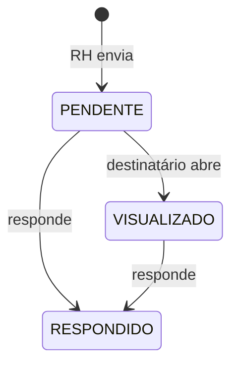

## Requisições do RH

O RH envia uma requisição (periódica, exame médico, férias, assinatura de documentos ou outra) a **um ou vários funcionários**, com título, descrição, anexo e prazo.

- Cada destinatário tem seu próprio estado (`RequisicaoRhDestinatario`).
- O funcionário vê e responde em **Minhas requisições**; o RH acompanha o andamento por destinatário.
- Há também requerimentos de **cadastro** (dependentes, formação, capacitações) e de **endereço** para o funcionário atualizar os próprios dados, individuais ou para todos.

## Saúde ocupacional

- Exames periódicos com periodicidade (padrão 12 meses) e aviso antecipado (padrão 30 dias).
- O RH solicita o exame; o funcionário envia o arquivo; o RH **confirma ou devolve** com motivo.
- Aviso diário às 07:30 (Brasília) de exames **a vencer** e **vencidos**.
- O arquivo do exame é dado sensível: fica em área privada e só é acessível a quem tem permissão (RH com a função liberada e o próprio funcionário).
