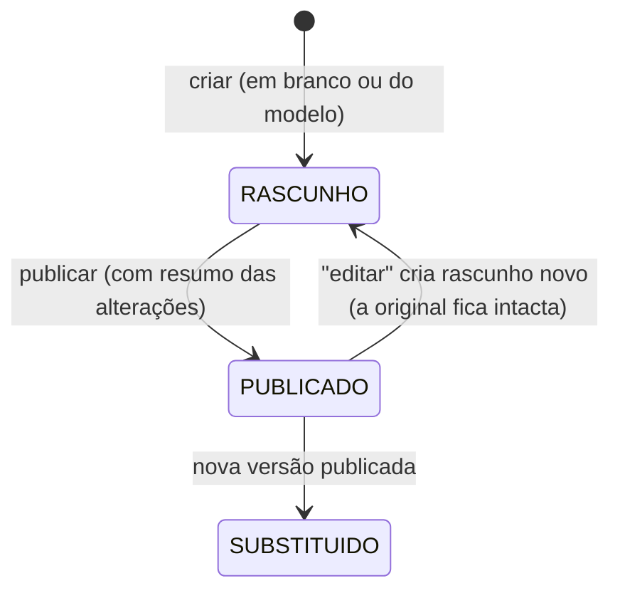

Os **Termos de Uso e Política de Privacidade** têm versões controladas pelo Super Admin; cada usuário precisa aceitar a versão vigente.

1. **Versionamento**: ao publicar, a versão anterior vira _substituída_. O texto publicado **nunca é alterado** — editar cria um rascunho.
2. **Aceite**: o usuário vê o termo (barra de rolagem até o fim) e confirma. O aceite é **somente inclusão** (`AceiteTermoUso`): usuário, versão, data, IP e dispositivo.
3. **Bloqueio**: enquanto houver versão publicada sem aceite do usuário, a API responde **428 `TERMOS_PENDENTES`** e o front abre o modal de aceite. **Exceções** (nunca bloqueados): registro de ponto e o que ele precisa (status, hora, comprovantes, foto), autenticação, os próprios termos e a verificação pública — a marcação não pode ser restringida (art. 74).
4. **Consulta**: _Meus aceites_ mostra o histórico; o Super Admin vê quem aceitou e quem **ainda não**.
5. **Cache**: a pendência por usuário tem cache curto, zerado ao aceitar e ao publicar.
