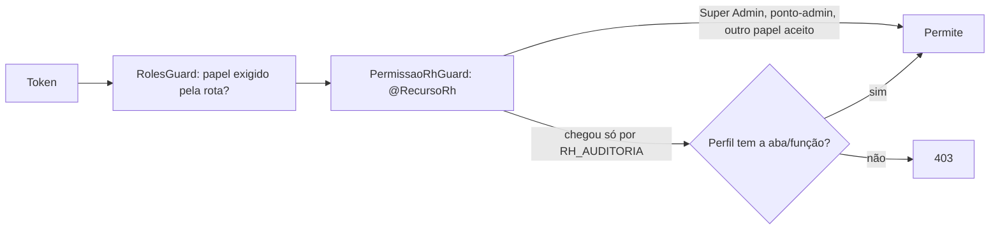

## Usuários

Usuários nascem no **primeiro login** (SSO) ou pela **sincronização de ramais**. O RH completa o cadastro (matrícula, categoria, lotação, jornada, chefia). Sem matrícula não há acesso. Desativar o funcionário bloqueia o login.

## Perfis do RH

Quem está na gerência de RH ganha `RH_AUDITORIA`, mas **o que pode fazer** vem de um **perfil do RH** (`PermissaoRh`): marcações por **aba** ("Ver") e por **função** (ações dentro da aba, que só valem com o "Ver" da aba-mãe). O catálogo (`recursos-rh`) é o mesmo no back e no front.

- **Super Admin e Gerente de RH** têm acesso total.
- Quem acessa a rota por outro papel aceito (ex.: gestor vendo a própria equipe) **não** é afetado pelo perfil.
- O RH pode **copiar** o perfil de um funcionário para outro.

## Super Admin

Concedido por variável de ambiente ou por **concessão registrada** (`SuperAdminConcessao`, com quem concedeu e revogação). Concessão e revogação geram notificação (`SUPER_ADMIN_CONCEDIDO/REVOGADO`). A tela _Sistema/Start_ centraliza usuários, grupos e super-admins.

## Start do sistema

A solicitação de _Start_ (go-live) passa por GERTI (TI) → RH → executada, definindo `dataInicioProducao` (a partir dela as regras de produção valem; antes é fase de teste).
