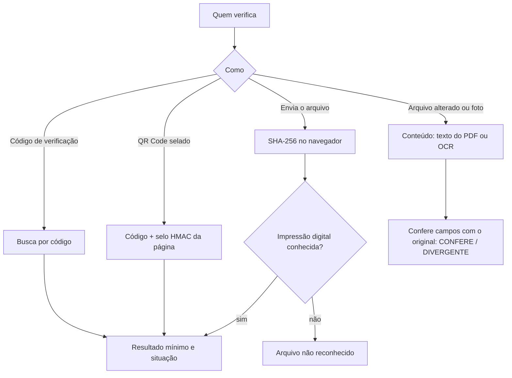

A página `/verificar` (e o botão **Validar documento** do sistema) permite que **qualquer pessoa**, sem login, confira se um documento foi emitido pelo sistema.

## O que é verificável

| Documento                                                                       | Como é reconhecido                                                                            |
| ------------------------------------------------------------------------------- | --------------------------------------------------------------------------------------------- |
| Espelho de Ponto (assinado)                                                     | Código, QR selado ou SHA-256 do PDF — inclusive **versões anteriores** (histórico de hashes). |
| Comprovante de Registro de Ponto                                                | Hash da marcação (64 caracteres), QR selado, número `CRP-…` ou SHA-256 do PDF.                |
| Relatório do ciclo de banco de horas, ciência de atestado, documentos de férias | SHA-256 registrado em `DocumentoEmitido`.                                                     |
| AFD / AEJ                                                                       | SHA-256 no `LEIA-ME` e em `ExtracaoArquivoFiscal`.                                            |

## Conferência do conteúdo

Quando o arquivo foi convertido, impresso ou editado (e por isso não tem a mesma impressão digital), a verificação lê o **texto do PDF** ou faz **OCR da foto** e confere nome, CPF, CNPJ, NSR, data, hora e hash com o original. No OCR tolera-se um bloco do hash mal lido; no PDF, nenhum. O resultado é `CONFERE` ou `DIVERGENTE` (listando os campos).

## Privacidade

A resposta pública traz o **mínimo**: nome mascarado ("Priscilla G."), datas, situação e hash — nunca CPF completo, endereço ou dados de jornada.

## Selo HMAC

Os QR Codes carregam registro, página, total e um selo HMAC derivado de segredo do servidor (`DOC_SEAL_SECRET`): impede forjar um QR com outro registro.
