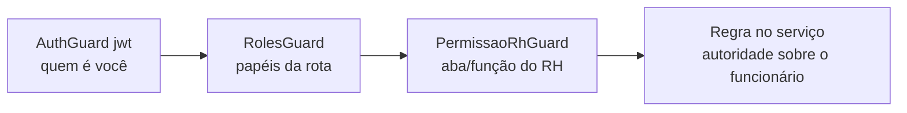

## Camadas

1. **AuthGuard("jwt")** — identidade válida.
2. **RolesGuard** — `@Roles(...)`: o usuário precisa ter ao menos um dos papéis; Super Admin passa sempre.
3. **PermissaoRhGuard** — `@RecursoRh(...)`: quando o usuário chega **só** pelo papel `RH_AUDITORIA`, exige a permissão da aba ("Ver") e, para ações, da função. Super Admin e Gerente de RH têm acesso total; quem chega por outro papel aceito não é afetado.
4. **Regras no serviço** — o chefe só age sobre a **própria equipe**; ninguém aprova a **própria** solicitação, fecha o próprio período ou aprova correção que criou (segregação de função); o funcionário só acessa os **próprios** comprovantes, documentos e exames.

## Papéis

`funcionario` (todos), `gestor`/`GESTOR_APROVACAO`, `RH_AUDITORIA`, `ponto-admin`/`PONTO_ADMIN` e Super Admin. Papéis críticos desativados geram aviso (`PAPEL_CRITICO_DESATIVADO`).

## Super Admin

Exclusivo para Logs, Documentação Técnica, REP-P, Termos de Uso, Sistema/Start e demais configurações críticas. Verificado por `assertSuperAdmin(req)` no controlador (HTTP 403 caso contrário). Concessões e revogações ficam registradas e notificadas.

## Autorização no front-end

O front esconde o que o usuário não pode usar (menus e botões), mas isso é **conveniência**: toda decisão é reaplicada no backend.

## Catálogo de acesso por rota

A seção _Catálogo de endpoints_ mostra, para cada rota, os papéis exigidos e os recursos do RH.
